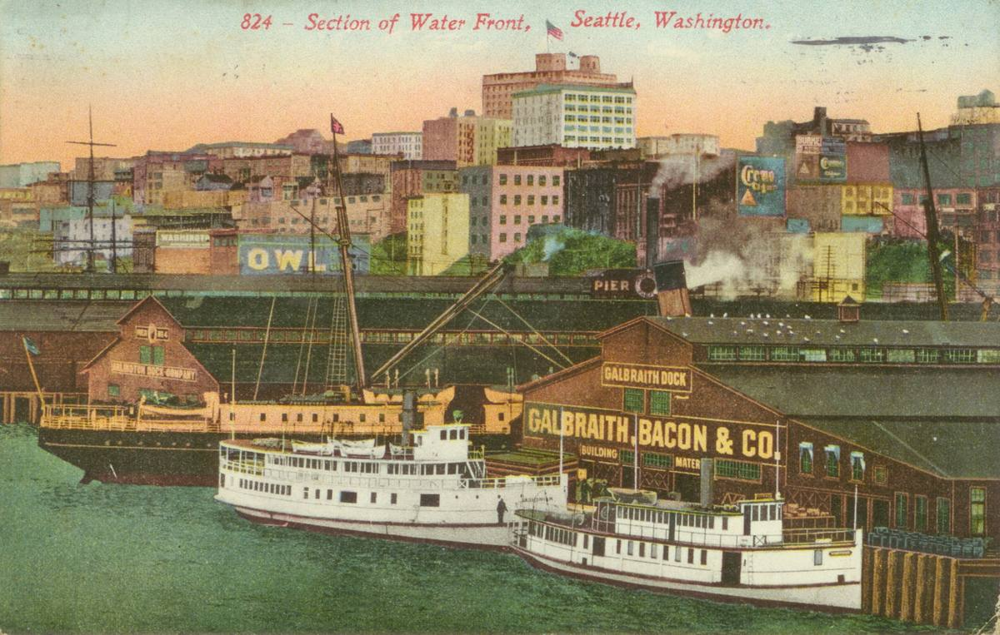
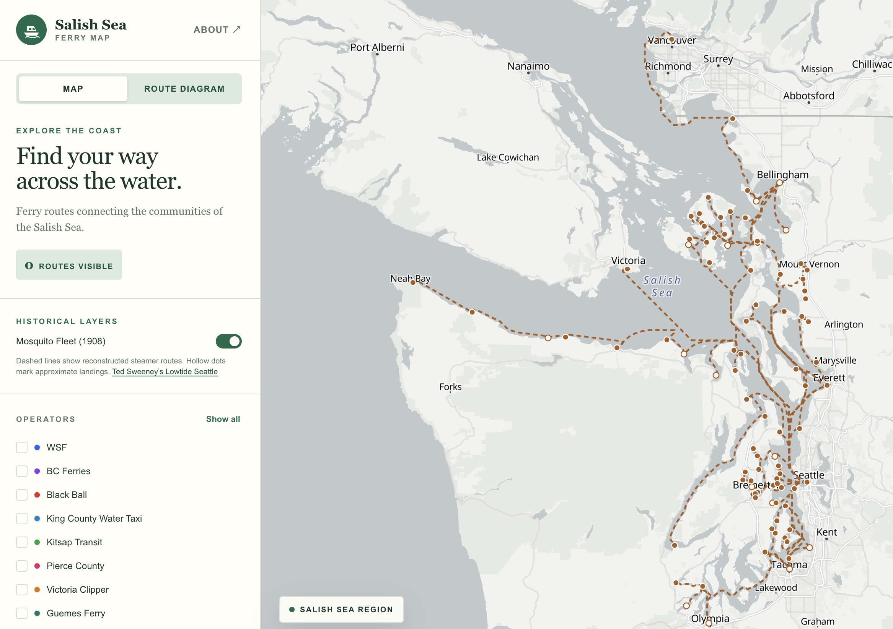
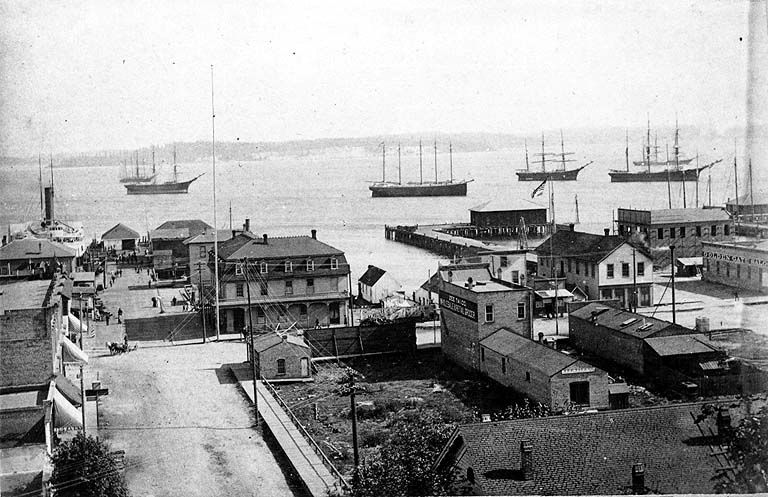
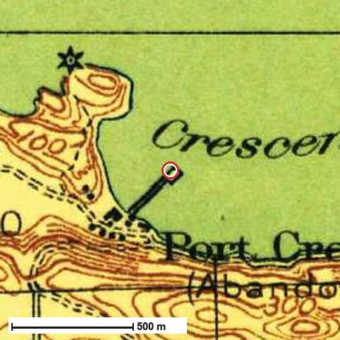
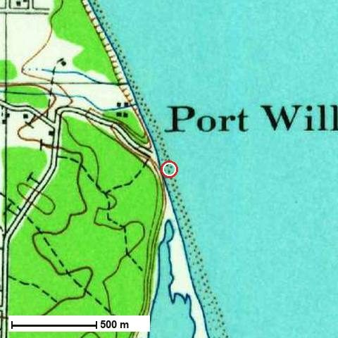

The first time I clicked the line between Seattle and Port Townsend, the map told me I was on my way to Victoria.

That was true. It was also a third of the answer. A reconstruction of the 1908 ferry network shows three steamer runs sharing the same stretch up Admiralty Inlet, all calling at Port Townsend before going their separate ways: one across the Strait to Victoria, one west along the Olympic Peninsula to Neah Bay, and one up into the San Juan Islands to Friday Harbor (the map calls it the San Juan Island run). Standing on the dock in Seattle, "next stop Port Townsend" told you almost nothing about where you'd end up.

<figure>
  
  <figcaption>The steamers <em>Vashonian</em> and <em>Norwood</em> at Galbraith Dock, Seattle, on a colorized postcard postmarked 1912. Public domain, via <a href="https://commons.wikimedia.org/wiki/File:Galbraith_Dock,_Seattle_WA_circa_1912.jpg">Wikimedia Commons</a>.</figcaption>
</figure>

I sail these waters, and I built the Salish Sea Ferry Map to answer a simple question about them: where can you go by ferry? This week I gave that question a year. Turn on **Mosquito Fleet (1908)** and dashed lines appear alongside today's crossings. They represent the steamer runs that tied Puget Sound's waterfront towns together when water was the primary means of travel. [Explore the Salish Sea Ferry Map](https://salishseaferrymap.com/).

<figure>
  
  <figcaption>The reconstructed Mosquito Fleet network with modern routes hidden. Historical data: Ted Sweeney, Lowtide Seattle; basemap: OpenFreeMap, OpenMapTiles and © <a href="https://www.openstreetmap.org/copyright">OpenStreetMap contributors</a>.</figcaption>
</figure>

Much of my work lately involves turning maps, charts and other media into structured data, with AI agents helping write the software. This layer exposed three problems with how I carried the evidence from source to screen: two about clicks, one about confidence. I missed all three. An AI code reviewer didn't.

## From newsprint to dashed line

In 1908 the *Seattle Post-Intelligencer* printed a map of steamer runs and a list of ports of call. A portion of the map is reproduced in [Kitsap Transit's passenger ferry study (Figure 1)](https://www.kitsaptransit.com/uploads/pdf/projects/kticpofbusinessplan_final.pdf).

For his [Lowtide Seattle](https://midtide.github.io/Lowtide-Seattle/) project, my friend Ted Sweeney reconstructed the runs using present-day OpenStreetMap waterway geometry. He recorded landing positions, their sources and notes on what the newspaper map actually shows. Many landings link to historical USGS topographic sheets.

There's a curious detail in Ted's reconstruction: the P-I's list of ports of call leaves out Port Townsend and Seattle, even though both appear on the map. Perhaps the editors assumed their readers already knew them.

I pinned [Ted's source data to a specific revision](https://github.com/midtide/Lowtide-Seattle/tree/184ca6be8bed363a04f0984e95fa06457edcdb44/data), joined the route geometry to the stop lists and kept the historical data separate from the present-day ferry network. The result is a GeoJSON file that your browser downloads only when you enable the overlay. The [data README](https://github.com/ivanoats/Salish-Sea-Ferry-Map/blob/main/data/README.md#historical-overlay) documents the transformation so someone else can reproduce it.

## Three runs, one answer

When you click a web map, MapLibre hands you every feature under the cursor, topmost first. My first version of the layer took the first one and showed it. Between Seattle and Port Townsend there are three runs stacked on the same stretch of water, so whichever was on top won, every time. Victoria got the credit. Neah Bay and Friday Harbor were invisible unless you knew to click somewhere else.

It was worse at the docks. Some 1908 landings sit exactly on today's terminals, at Anacortes, Guemes and Lummi Island, so turning on history quietly replaced the popup for the present-day ferry terminal you'd just clicked.

My [pull request](https://github.com/ivanoats/Salish-Sea-Ferry-Map/pull/87) reported 124 passing tests, a clean build and a browser smoke test, and none of that caught either click problem. GitHub Copilot's [review of the shared route](https://github.com/ivanoats/Salish-Sea-Ferry-Map/pull/87#discussion_r4595434772) identified the problem with `features[0]`: it discarded the other hits. A [second comment](https://github.com/ivanoats/Salish-Sea-Ferry-Map/pull/87#discussion_r4595434741) identified the three overlapping historical and modern terminals.

Nothing was wrong with the data. The click handler made an editorial decision: *this is the run you meant*. The data contained three valid answers, but the interface would only show one.

Copilot's coding agent proposed the change: gather everything under the click, drop the duplicates, and if more than one thing is there, ask. Click the shared stretch now and the map asks you to choose: *1908 run: Seattle – Victoria*, *Seattle – Neah Bay* or *Seattle – San Juan Island*. Click the Anacortes dock and today's terminal is one of the choices. It shipped with regression tests for both cases.

That change introduced its own problem. [DeepSource flagged the revised click handler](https://github.com/ivanoats/Salish-Sea-Ferry-Map/pull/87#discussion_r4621612403) for cyclomatic complexity: 32, rated very high risk. The agent had solved the interaction problem by growing one function. A second pass split the feature-specific logic out, and DeepSource passed.

The automated review, regression tests and static analysis each caught something different. My job was to decide what the map should communicate and verify that the changes did it.

## Past Port Townsend

Follow the Neah Bay run west. After Port Townsend come Port Williams, New Dungeness, Port Angeles, Port Crescent and Gettysburg, then Clallam Bay and Neah Bay. That's the part I linger over. Seattle and Neah Bay make a tidy pair of endpoints, but if you lived at Port Williams, a landing near Sequim, your whole part of the story was the boat that stopped there.

<figure>
  
  <figcaption>Port Townsend's waterfront around 1890, in its boom years. Public domain, University of Washington Libraries via <a href="https://commons.wikimedia.org/wiki/File:Port_Townsend_waterfront_ca_1890_(01).jpg">Wikimedia Commons</a>.</figcaption>
</figure>

Keep tracing and you'll get farther than the newspaper did. The P-I map ran out of paper at its western edge. Instead of drawing the rest, it put an arrow in the margin: "To Clallam, Neah Bay." Mapmakers have always done this. When the world is bigger than the sheet, you point. Ted carried the line on to those towns and wrote the arrow into his notes, and because the pipeline carries notes along with geometry, you can read it right on the ferry map. Pick the Neah Bay run from that shared-stretch menu and it's there. A pipeline that kept only the line would have quietly turned an arrow into a fact.

## A strong match for the wrong question

Farther south, look for Seacoma Beach. There's a fishing pier at Redondo Beach, and we can put a pin on that pier with considerable precision. Its coordinates carry five decimal places, which is about a meter. The open question is whether the place the old map calls Seacoma Beach belongs at that spot at all. Redondo is the reconstruction's best guess.

When I first opened the pull request, Seacoma had a solid dot, and the record said why: "Redondo Fishing Pier (strong match)." The match was real. The matching step had found a pier, and the pier was exactly where it said. But "strong match" answered how well the dot fit a dock, not whether the name belonged there. The notes field on the same record called the position a guess. One record, two kinds of confidence, and the symbol only had room for one.

The same AI reviewer [caught this discrepancy](https://github.com/ivanoats/Salish-Sea-Ferry-Map/pull/87#discussion_r4595434708). A good match to a modern pier does not establish that the historical landing was there. It's a problem I watch for in AI-assisted data pipelines: a confidence label that answers one question gets interpreted as confidence in something else.

Cartographers know this as precision versus accuracy. A crisp symbol can imply more certainty than the evidence warrants. Seacoma got its hollow dot before the layer merged. There are 15 approximate landings among the 93 ports in the layer. Each hollow dot tells you that its location remains uncertain.

<figure class="half">
  
  
  <figcaption>Left: Port Crescent on the USGS Port Crescent 1919 sheet. The documented wharf supports the landing location, though the survey is eleven years later than the newspaper map and cannot establish exactly where the steamer landed in 1908. Right: Port Williams on the USGS Dungeness 1938 sheet. No dock is drawn and the historic landing remains unidentified, so its location is estimated. USGS Historical Topographic Map Collection (public domain), crops via <a href="https://midtide.github.io/Lowtide-Seattle/">Lowtide Seattle</a>.</figcaption>
</figure>

The 37 steamer runs are reconstructions too. A dashed line tells you which communities a run linked. The course a skipper steered on a particular morning is another question, and the dashes are there so you don't forget it. Source data and map credits are in the [data README](https://github.com/ivanoats/Salish-Sea-Ferry-Map/blob/main/data/README.md).

## What a data pipeline needs to preserve

Three details turned out to matter as much as the coordinates themselves:

- **Cardinality:** preserve one-to-many relationships throughout transformations. A single stretch of water can represent several distinct runs.
- **Provenance:** retain source references and reconstruction assumptions. The note about the newspaper's marginal arrow distinguishes the source from the reconstruction.
- **Uncertainty:** model uncertainty explicitly rather than inferring it from coordinate precision. An exact coordinate can still describe an approximate historical location.

When designing a data pipeline, I want each of these to survive the transformation from the original source all the way to the interface. That's an architectural requirement, whether a person or an AI agent writes the code.

## Start at your dock

If you know a stretch of this shoreline, start there. Find the landing nearest you, pick a run and see where the boat called next. And if you know where Seacoma Beach's dock really was, or Port Williams', I'd like to hear it.

I started with the familiar crossing out of Seattle and came away wanting to know more about Port Williams.
